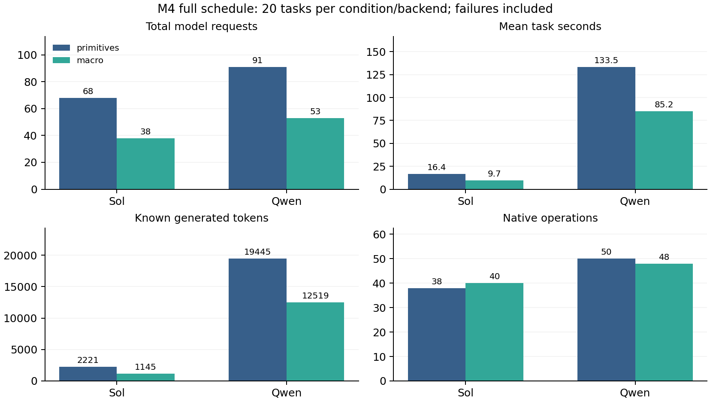

# Reducing LLM orchestration overhead in ROSA through bounded robotic skill macros

**Research report · 2026-10-27**

**Review update · 2026-10-30:** [Human-review resolution and future task wording](HUMAN_REVIEW_RESOLUTION_2026-10-30.md).
All eight submitted ratings are preserved. The reviewer clarified an outcome-oriented
preference and requests concise, explicit task wording. This closes stakeholder
feedback; independent human adjudication under the frozen criterion was not obtained.
See also the [initial intake](HUMAN_REVIEW_AND_PROMPT_CLARITY_2026-10-29.md).
The original results below and the archived ten-page PDF are unchanged.
The earlier statements about deferred review describe the original report date.

**Backup update · 2026-10-30:** [M5 technical closeout and verified local backup](../../docs/M5_CLOSEOUT_AND_LOCAL_BACKUP_2026-10-30.md).
Available history through research b13df0f and evaluation b5e94bf was restored and
verified locally with shallow-history metadata. Evaluation off-machine protection
remains deferred; no upload or new experiment was performed.

We implemented bounded robotic skill macros within a repaired ROSA framework and evaluated them against model-managed primitive execution. On the tested catalogue, macros reduced LLM orchestration overhead while producing mixed correctness outcomes. Sol passed all20 tasks in each condition; Qwen passed15/20 with primitives and14/20 with macros. Five accepted, evidence-grounded reports failed the requested goal. The results support efficiency benefits in this environment, without establishing general reliability improvement or superiority to unmodified ROSA.

| Backend | Correct: primitive / macro | Calls | Mean task seconds |
|---|---|---|---|
| Sol | 20/20 /20/20 | 68 →38 | 16.42 →9.73 |
| Qwen | 15/20 /14/20 | 91 →53 | 133.49 →85.18 |

**Decision:** Sol passes the prospective engineering screen; Qwen fails its no-greater-failure criterion. Keep the module optional and bounded. Do not interpret cheaper failed tasks as reliability improvements. M5 is postprocessing/delivery, not another research campaign.

Prepared from frozen source, saved M4 attempts and explicitly labeled retrospective analysis. Independent human clarification adjudication is deferred at the user’s request; operator ratings and a label-withheld reviewer packet are retained separately.

## 1. Component and task contract

This work extends [ROSA](https://arxiv.org/abs/2410.06472v2) with pre-authored bounded routines. [SayCan](https://arxiv.org/abs/2204.01691v2) grounds language in robot skills; [Code as Policies](https://arxiv.org/abs/2209.07753v4) generates robot programs. These are context, not experimental baselines. Our contribution is implementation and measured trade-offs; no novel macro-action algorithm is claimed.

There is one six-joint UR5e arm, **one state-changing movement capability** with home, stage_left and park_right targets, and **one read-only readiness capability**. Four catalogue entries are not four robotic capabilities. This is not a one-actuator robot or a demonstration of chained multi-skill autonomy.

| Public tool | Responsibility |
|---|---|
| select_skill | Model selects one permitted exact ID. Primitives returns targets; macro performs bounded routine. |
| read_state | Acquire fresh permitted evidence, preserving unavailable observations. |
| write_state | At most one necessary authorized movement with known prerequisites and exact registered targets. |
| verify_outcome | Fresh selected-goal/readiness check, callable by model or program. |
| submit_report | Model classifies SUCCESS/FAILURE/UNKNOWN and cites latest observation ID; program supplies/checks exact recorded values. |

The application grants allowed skills. The model does not infer new permissions from prose. Both modes commit to one selected skill per invocation; selection in macro mode immediately runs routine operations. Incorrect selection can be locked in. Unknown/ineffective commands are not replayed, and accepted reports terminate without an extra acknowledgement.

HOME=(0,−1.57,1.57,−1.57,−1.57,0). M4 stage_left has pan−0.14/final wrist0.20; park_right has pan0.16/final wrist−0.12. All targets stay within0.4 rad of HOME. Commands use the standard trajectory controller and three-second trajectories. Final joint tolerance is0.025 rad. Command acceptance is not physical verification.

Readiness separately queries controller activation and fresh complete finite joint data. It has no trajectory publisher. True/false/unavailable facts use1/0/null encoding. Readiness SUCCESS requires all checks true; observed unready is FAILURE, missing evidence UNKNOWN. Readiness does not authorize motion or certify collision safety.

Shared guards validate selected evidence/classification, not arbitrary natural-language intent. The external evaluator separately checks the requested goal and fault exercise. A model-generated prose statement is not exhaustively verified by the structured report validator.

## 2. Frozen study design and resources

Ten prospective families × two repetitions × two conditions × two backends produce80 trials:20 per condition/backend. Cases were authored by this project and frozen before inference. Repetitions are repeated cases, not independent new tasks. The four examined partial-command first inputs are identical within each condition’s repetitions.

| Families | Coverage |
|---|---|
| Movement (five) | Constrained goal selection; already-satisfied goal; suppressed ineffective command; actual partial wrist command; missing movement prerequisite. |
| Inspection (four) | Healthy readiness; actually inactive controller; missing controller observation; missing joint observation. |
| Ambiguity (one) | Request clarification before any selection/acquisition/report. No movement permission. |

Adjacent paired order is counterbalanced, with case rotation between repetitions and reversed condition ordering across backends. Sol runs before Qwen; simulator access is serialized. Before live execution,20 deterministic controls and their exact Phoenix audits passed. Resets, independent observations and controller fault setup are outside the task loop and separately accounted.

| Limit | Value |
|---|---|
| Per task | 8 charged calls;2,048 observed generated tokens;10 native operations;16 tool attempts;3 permitted corrections;360 seconds;≤1 movement dispatch. |
| Qwen generation | num_ctx8192; up to1,024 output tokens/call within remaining allowance; temperature0, seed42, mmap; no reasoning/stream/cache. |
| Backend | 320 ordinary request slots+3 eligible infrastructure slots=323;8-hour ceiling, not forecast. |
| Recovery | At most one eligible HTTP502/503/504 retry/logical call; no quota/auth/timeout/length or robot-command replay. No reserve was used. |

Local Qwen3.5:9b Q4_K_M uses pinned Ollama0.40.6 on an RTX4050 laptop with6GB VRAM and nominal16GB RAM. Hosted gpt-6.1-sol uses the existing ChatSiwc OAuth adapter and provider defaults. Equal budgets within a backend do not imply equal hardware, tokenization or provider generation caps across models.

Frozen source: research c0c61a0, evaluation4412f05;62 file hashes and applicable research/ Phoenix locks. Protocol and source copies remain unchanged. All250 requests have known usage; there are no censored, replaced, extended or unstarted M4 cells.

## 3. Correctness by family and paired outcome

| Family | Sol P | Sol M | Qwen P | Qwen M |
|---|---|---|---|---|
| already satisfied | 2/2 | 2/2 | 2/2 | 2/2 |
| ambiguous goal | 2/2 | 2/2 | 0/2 | 0/2 |
| ineffective command | 2/2 | 2/2 | 2/2 | 2/2 |
| inspect healthy | 2/2 | 2/2 | 2/2 | 2/2 |
| inspect inactive | 2/2 | 2/2 | 2/2 | 2/2 |
| inspect missing controllers | 2/2 | 2/2 | 2/2 | 2/2 |
| inspect missing joint | 2/2 | 2/2 | 2/2 | 2/2 |
| missing prerequisite | 2/2 | 2/2 | 0/2 | 0/2 |
| move constrained | 2/2 | 2/2 | 1/2 | 2/2 |
| partial command | 2/2 | 2/2 | 2/2 | 0/2 |

P=primitives, M=macro. Passing includes the correct grounded FAILURE/UNKNOWN or clarification in the applicable case; these percentages are not physical movement success rates. A partial-command case must actually exercise the injected command.

| Backend | Both pass | P-only | M-only | Both fail |
|---|---|---|---|---|
| Sol | 20 | 0 | 0 | 0 |
| Qwen | 13 | 2 | 1 | 4 |

Qwen’s one macro-only success is constrained selection repetition2. Its two primitive-only successes are partial-command repetitions1/2. The four both-fail pairs are missing movement prerequisites and ambiguous intent, each repeated twice.

The prospective screen requires all20 pairs and audits, no dispatch violations, no greater count of primary failures,≥25% fewer calls on both-pass pairs and≤25% extra native operations on that subset. Sol passes. Qwen fails because macro has six failed tasks versus five with primitives. This gate is a development decision, not evidence of statistical harm, equivalence or population-level reliability preservation.

Sol’s ceiling result means no failures were observed in this suite, not that unseen failure probability is zero. Qwen’s one-task difference remains uncertain at this sample size. We retain the predefined gate rather than changing it after results.

## 4. Efficiency and elapsed time

**Both-pass pairs: conditional cost of successful completion**

| Backend/mode | Pairs | Calls | Input | Output | Native | Task sec |
|---|---|---|---|---|---|---|
| Sol P | 20 | 68 | 95,333 | 2,221 | 38 | 328.36 |
| Sol M | 20 | 38 | 48,754 | 1,145 | 40 | 194.58 |
| Qwen P | 13 | 53 | 114,556 | 10,231 | 31 | 1,417.23 |
| Qwen M | 13 | 28 | 48,872 | 5,149 | 29 | 696.76 |

**All attempts: actual complete-schedule expenditure**

| Backend/mode | Pairs | Calls | Input | Output | Native | Task sec |
|---|---|---|---|---|---|---|
| Sol P | 20 | 68 | 95,333 | 2,221 | 38 | 328.36 |
| Sol M | 20 | 38 | 48,754 | 1,145 | 40 | 194.58 |
| Qwen P | 20 | 91 | 207,958 | 19,445 | 50 | 2,669.72 |
| Qwen M | 20 | 53 | 105,779 | 12,519 | 48 | 1,703.63 |

On both-pass pairs, Sol saves44.1% calls and40.7% task time; Qwen saves47.2% calls and50.8% task time. The matched subset has20 Sol pairs but only13 Qwen pairs, excluding discordant/harder cases. All-attempt call savings are44.1% and41.8%; Qwen’s all-attempt time reduction is36.2%. Neither view replaces correctness.

Native work is heterogeneous. Sol38→40 (+5.3%) is explained by the already-satisfied cases: primitives uses one fresh read per case, while macro uses two. Qwen50→48 (−4.0%) includes missed commands and different reads; both-pass31→29 is−6.5%. Counts are not equal-duration operations, energy or monetary charges.

| Backend/mode | Mean sec | Median sec |
|---|---|---|
| Sol primitives | 16.42 | 13.18 |
| Sol macro | 9.73 | 8.57 |
| Qwen primitives | 133.49 | 117.59 |
| Qwen macro | 85.18 | 46.53 |

Closed backend time including setup/reset/independent checks/audit/cleanup is17.68 minutes for Sol and81.97 for Qwen. Task loops account for8.72 and72.89 minutes; non-task overhead is8.96 and9.08 minutes. Waiting for the other backend is excluded. Task-loop time is not pure generation speed; backend/hardware/order differences preclude an intrinsic cross-model speed ranking. Repeated input tokens are counted per request, not unique language content or an estimate of billed dollars.

## 5. Uncertainty: descriptive evidence first

All analysis on this page is explicitly post hoc. The ten-family table and paired outcomes carry the main interpretation. Neither repeated fixed-seed cases nor a large span count supply independent task diversity.

| Backend | Metric | 95% empirical family range |
|---|---|---|
| Sol | Correctness difference (pp) | 0.0 to 0.0 |
| Sol | Both-pass call reduction (%) | 33.3 to 52.5 |
| Sol | Both-pass time reduction (%) | 26.2 to 49.1 |
| Qwen | Correctness difference (pp) | -30.0 to 15.0 |
| Qwen | Both-pass call reduction (%) | 33.3 to 59.2 |
| Qwen | Both-pass time reduction (%) | 27.1 to 64.7 |

Resample whole families10,000 times, seed20261027, preserving both repetitions and conditions. Ranges are2.5th/97.5th percentiles, a sensitivity to the observed family mix, not calibrated guarantees for unseen tasks. Zero denominator draws are omitted per metric and counted in the JSON output.

Sol’s zero correctness-difference range is degenerate because every observed case passed; this bootstrap cannot invent failures. It does not demonstrate noninferiority. Under an independent-binomial reference only, Wilson95 for20/20 is approximately83.9%–100%. That model ignores this study’s pairing/clustering and is neither the true design-adjusted uncertainty nor a guaranteed lower bound.

The exact family-level sign-flip sensitivity returns p=1.0 for both backends. It assumes condition-label exchangeability/symmetry not established by the designed suite; Sol has no variation and Qwen only two families with nonzero condition differences. This is not evidence that the one-task difference is definitely noise.

Methodological references: [NIST proportions intervals](https://www.itl.nist.gov/div898/handbook/prc/section2/prc241.htm) and [Cameron–Miller cluster inference](https://cameron.econ.ucdavis.edu/research/Cameron_Miller_JHR_2015.pdf). Few hand-authored clusters and selected-success conditioning remain substantial limitations. No exploratory statistic changes the frozen engineering screen.

## 6. Retrospective forensic review: partial-command pairs

These four cases distinguish Qwen’s conditions: both primitive cases pass and both macro cases fail. Outcomes and some snapshots/prompts were already seen. The earlier review handoff recorded a wording hypothesis; deeper first-turn inspection is retrospective, not a blind or preregistered causal test.

| Step | Primitives: both repetitions | Macro: both repetitions |
|---|---|---|
| Visible inputs | Same system prompt, five schemas, catalogue and movement request. | Same as primitives; user-message execution-condition sentence differs. |
| First request | read_state(/ur5e_readiness), before selection; rejected without data. | select_skill(inspect_readiness); permitted, immediately executes inspection. |
| Next selection | select_skill(park_right); accepted. | select_skill(park_right); rejected as already selected. |
| Later behavior | Premature write blocked; fresh read, one partial command, verification and FAILURE report. | r1: FAILURE about readiness rejected, then readiness SUCCESS accepted. r2: length stop. |
| Fault exercise | Actual injected partial wrist movement exercised twice. | No movement; partial-command fault never exercised. |

Both conditions show a readiness-first initial tool request. The primitive pre-selection rejection leaves the skill choice open; the macro selection commits it. Both modes later request the correct park_right skill. Thus the records do not support an absolute claim that Qwen could not identify the movement goal. They expose different action/feedback paths under the shared one-skill rule.

The select_skill description itself is identical across modes. There is no first-call prose in the macro choices demonstrating a belief that inspection was cheaper/safer. Later model explanations are observable text, not privileged causal access. Wording and execution/commitment interaction are plausible hypotheses; these records do not isolate why the first actions differed.

Changing selection/commitment policy could change permissions and replay risk. No runtime repair was made and no additional diagnostic was run. Exact decoded prompts, schemas, call sequences, tool feedback and source trace hashes accompany PARTIAL_COMMAND_FORENSIC_REVIEW.md and partial-command-forensics.json.

## 7. Goal truth, fault coverage and review quality

All11 failed Qwen tasks selected readiness inspection: seven explicit movement requests and four ambiguous requests requiring clarification. Five ended with accepted grounded readiness SUCCESS, while six ended with safe error output (five length stops and one validation-retry exhaustion). These are distinct failure modes, not eleven hallucinated-success reports.

In macro partial-command repetition1, Qwen explicitly attempts a FAILURE report after recognizing the requested movement was not performed. The validator rejects that classification because the *selected readiness skill* succeeded. The accepted replacement SUCCESS is true about readiness but does not satisfy the movement request. This illustrates the scope of skill-level verification.

Sol exercises all required faults. Qwen’s primitive partial-command cases exercise actual partial movement; its macro counterparts and all four missing movement-prerequisite cases select inspection and miss intended fault coverage. Truthful unrelated observations are not credited as fault handling.

All80 live local and exact persisted-Phoenix audits match3,290 spans;20 deterministic controls add202. No dispatch violations, uncertain-command replay or missing usage were observed. Both simulators cleaned up. Verification uses separate actor/evaluator state and transport instances on the same simulator and APIs, not independently authored scoring or a different physical sensor.

All eight clarification cases have stored Codex operator ratings: four Sol passes and four Qwen failures. **Independent human review is deferred by user choice.** A packet with model/condition labels and previous scores withheld is prepared, with empty ratings and a separate operator key. Response style may reveal labels. Future human ratings/disagreements must be preserved separately, not silently substituted into frozen M4 results.

Cryptographic archive checks establish byte identity. Trace accounting checks instrumentation completeness. Neither alone proves a correct task contract, causal explanation, broad reliability or safety.

## 8. Reproducibility and delivery acceptance

Frozen M4 inputs, scores and archives are unchanged. M5 creates separate postprocessing reports, reviewer materials, package checks and presentation recordings. Source lists/digests, exact commands, tables and scripts accompany the delivery. M4 final ZIP remains separately immutable.

Credential checks covered intended branch history and retained evidence, including archive entries. Two exact source-file sentinel literals were reviewed as expired noncredentials; the initial finding and resolution are retained. The retained-work backup contains4,423 files, SHA256 b8ef4c05300460dcb72f218de73adec7b08599ec1d409c617eafe0c93099c580. Pattern checks cannot prove absence of all possible secrets. Protected credentials, local service databases and environments are excluded.

The first backup filter also excluded14 historical uv.lock copies by treating all .lock files as transient. The filter is corrected, and a separately verified dependency-lock addendum preserves those copies without replacing the original backup. Current committed locks were already protected by repository history.

Off-machine verification is recorded: Research branch and every file in its remote source tarball are verified; evaluation upload remains pending explicit destination/disclosure approval.

Offline build/empty-target installation passed using the existing pinned Python3.12 dependencies and ROS stack. Movement and inspection public API checks and installed CLI help passed, with no experiment imports. This is not a fresh-OS/dependency-free installation. The wheel is the modified jpl-rosa1.0.10 distribution with internal component0.2.0, not a separately published package.

An initial smoke probe incorrectly accessed an internal operations field; its failed attempt is preserved. The corrected public snapshot probe passed without changing runtime source. A zero-model Gazebo camera preflight passed.

| Presentation run | Independent outcome | Model requests | Camera frames |
|---|---|---|---|
| Sol | verified goal | 2 | 130 |
| Qwen | verified goal | 2 | 402 |

Presentation recordings are isolated Gazebo-camera footage, not desktop capture, archived-model replays or additional M4 observations. The static camera/rendering world is an additive presentation fixture; robot/controller/guard source is unchanged. These runs are not used for efficiency inference. Edited pauses and video-speed changes must be labeled. Each model run is bounded at eight requests; failed takes are retained, not repeated to obtain a success.

Human-review completion and remote publication status must be read from the current M5 progress record; a locally prepared ZIP or an old report does not establish either. The living master README remains the current project entry point.

## 9. Discussion, conclusion and references

The engineering benefit is reduced LLM orchestration overhead in a small, bounded ROSA configuration. Bundling removes decision points but may add native reads, commit an unsuitable skill earlier, or shift the feedback path. The working module and bounded empirical findings are useful without claiming a new algorithm. Efficiency and task correctness must be presented together.

- No untouched-upstream ROSA comparison: only execution ownership within the repaired reference is isolated.
- One arm, short tasks, ten designed families, repeated fixed-serving cases and two backends limit generalization.
- Five wrong-goal grounded reports are empirical examples of a familiar distinction, not a universal failure rate.
- Operator-authored evaluator/review, deferred human adjudication and a small selected-success cohort remain limitations.
- No physical hardware, obstacle/path safety, grasping, perception, autonomous skill chaining or memory claim.

No optional experiment is scheduled. A later selection diagnostic would need a specific decision-changing question and separate frozen protocol; it could test presentation sensitivity, not establish a general capability explanation. A stock-ROSA comparison is necessary for stronger upstream-superiority claims, not for the narrower measured contrast reported here.

**Conclusion:** bounded macros reduced calls and measured task-loop time on this catalogue. Sol showed no observed failures; Qwen failed the preset reliability-preserving screen. Skill-level evidence truth did not guarantee correct user intent. These conclusions are intentionally limited to what the implementation and archived evidence establish.

**References (primary sources; checked2026-10-27)**

- Royce et al. Enabling Novel Mission Operations and Interactions with ROSA. [arXiv2410.06472v2](https://arxiv.org/abs/2410.06472v2).
- Ahn et al. Do As I Can, Not As I Say. [arXiv2204.01691v2](https://arxiv.org/abs/2204.01691v2).
- Liang et al. Code as Policies. [arXiv2209.07753v4](https://arxiv.org/abs/2209.07753v4).
- NIST/SEMATECH. [Proportion confidence intervals](https://www.itl.nist.gov/div898/handbook/prc/section2/prc241.htm).
- Cameron and Miller (2015). [A Practitioner’s Guide to Cluster-Robust Inference](https://cameron.econ.ucdavis.edu/research/Cameron_Miller_JHR_2015.pdf).

Appendices: frozen M4 protocol/evidence; full traces and retrospective extraction; family/paired/cost CSVs; exploratory analysis JSON; human-review packet/key; installation acceptance; demonstration provenance/video; backup and integrity manifests.

