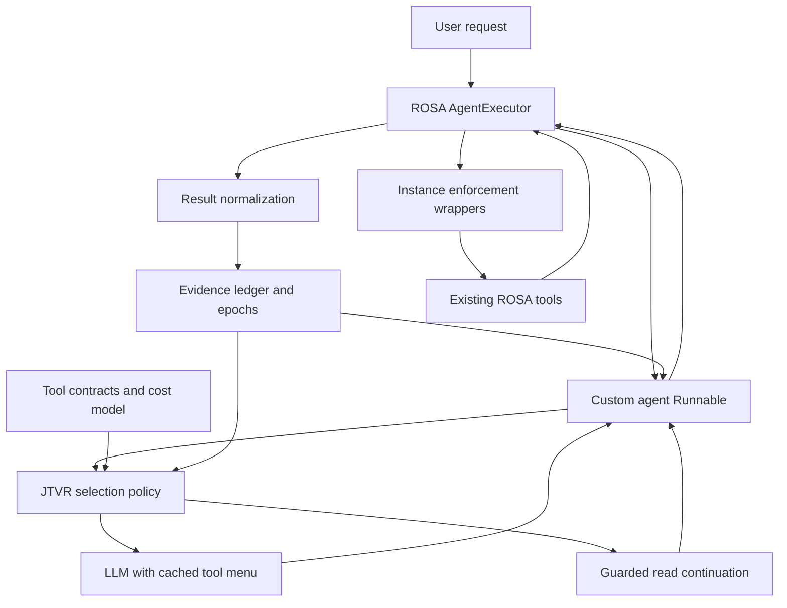

# JTVR: final technical algorithm specification untuk ROSA

**Working title:** *Bounded Joint Task–Verification Retrieval with Cost-Aware Read Continuations for ROSA*.

**Status:** research design, 12 Oktober 2026. Dokumen ini bukan implementation, hasil eksperimen, atau final proposal. Tidak ada klaim peningkatan performa yang sudah terbukti.

## A. Executive summary

Masalah yang kita targetkan cukup spesifik: agent bisa melakukan beberapa read untuk menyelesaikan task dan beberapa read lagi untuk verification, padahal informasi yang dibutuhkan tumpang tindih. Sebaliknya, tool yang membuka akses ke bulk read bisa diabaikan karena tidak langsung menjawab permintaan pengguna. ROSA punya peluang nyata untuk kasus ini, terutama parameter inspection melalui `ros2_param_get` versus standard ROS 2 `GetParameters` yang dapat dipanggil lewat `ros2_service_call`.

JTVR final adalah **tool-selection policy di dalam custom agent Runnable**, tetap memakai ROSA AgentExecutor dan existing tools. Policy menyatukan kebutuhan task dan verification menjadi evidence obligations yang didedup; menyimpan hasil dengan provenance dan aturan invalidation; lalu membandingkan greedy completion dengan read-only fragments pendek berdasarkan **biaya fragment ditambah biaya kebutuhan yang masih tersisa**. Sebuah discovery call boleh dipilih meskipun coverage langsungnya nol, kalau ia membuka pembacaan gabungan yang diperkirakan lebih murah. Setelah LLM menyetujui root fragment, satu continuation yang aman bisa dijalankan tanpa inference tambahan, menggunakan hasil nyata untuk mengikat arguments.

Evidence reuse, batching, verification, dependency filtering, dan bounded lookahead sudah punya prior art. Bentuk biaya prefix plus greedy cost-to-go juga merupakan established bounded rollout. Kontribusi yang kita ajukan lebih sempit: shared task–verification obligations, execution/LLM cost accounting, dan bounded read continuations pada tool calling ROSA. Kita tidak mengklaim menemukan batching atau rollout baru.

Pembanding terberat justru **amortized batching dengan evidence reuse dan discovery-cost accounting**. Ia bisa memilih urutan yang sama dengan JTVR. Karena itu eksperimen harus memisahkan manfaat selection, reuse, dan pengurangan inference; keuntungan terhadap original ROSA saja belum cukup membuktikan kontribusi.

**Bisa lanjut ke proposal preparation.** Topiknya defensible untuk Special Project S1 dengan kontrak terbatas, beberapa parser, mocked ROS tools, dan ROS 2 Jazzy tanpa robot. Expected advantage bersifat kondisional, terutama ketika discovery membuka bulk evidence untuk beberapa kebutuhan sekaligus. Kalau strong LLM atau batching baseline sudah memilih urutan yang sama, hasil itu tetap penting dan harus dilaporkan sebagai batas metode. Ketidakpastian performa masuk hypothesis eksperimen, bukan alasan menunda spesifikasi algoritma lagi.

---

## B. Detailed technical specification

### 1. Landasan dan batas evidence

Dokumen ini mempertahankan temuan dua report proyek sebelumnya: refinement JTVR dan audit architecture/tools ROSA. Koreksi utamanya adalah menghilangkan double counting antara task dan verification serta menghindari tambahan inference pada setiap langkah fragment. Audit source menggunakan ROSA commit `e7e53754bed673e2ce36d1fa311e04e51bfbacad`, version `1.0.10`. Source links di daftar referensi dipin bila memungkinkan.

Label yang dipakai:

- **Source-verified:** perilaku yang terlihat pada source atau primary specification yang diperiksa.
- **Proposed:** komponen JTVR yang belum diimplementasikan.
- **Hypothesis:** expected benefit yang harus diuji.
- **Unverified:** detail yang tidak boleh dianggap fakta implementasi.

Target kita adalah efisiensi **acquisition of required evidence**, termasuk evidence untuk menyatakan task berhasil. JTVR bukan planner untuk menghasilkan rangkaian arbitrary robot actions. Write actions tetap dipilih LLM. Policy tidak mengotomatisasi diagnosis seluruh sistem, tidak membuat probabilistic world model, dan tidak mengasumsikan hasil future calls benar.

### 2. Apa yang tersedia di ROSA

**Source-verified.** `src/rosa/rosa.py::_get_agent()` memanggil `create_tool_calling_agent` dengan seluruh registered tools. `_get_executor()` membangun `AgentExecutor` yang memakai agent tersebut. Tools default dipilih berdasarkan ROS version oleh `src/rosa/tools/__init__.py`; menambahkan custom tools tidak otomatis mengganti default tools. Blacklist ROSA terutama menyaring entities melalui functions terkait; ia bukan enforcement policy untuk dynamic tool instances. [R1–R3]

Tools paling relevan untuk prototype ROS 2:

| Existing tool | Inputs dan result | Coverage yang sah | Batas penting |
|---|---|---|---|
| `ros2_node_list` | optional pattern; dictionary berisi daftar nodes | node discovery | Daftar saat inspection, bukan liveness guarantee. |
| `ros2_service_list` | optional pattern; daftar service names | endpoint discovery | Tidak mengembalikan request schema atau current parameter values. |
| `ros2_node_info` | `nodes: List[str]`; mapping node ke CLI text/error | Subscriber, publisher, service/action endpoint names dan types untuk node tersebut | Node-scoped; bukan global graph atau endpoint QoS. Loop satu CLI command per node. |
| `ros2_topic_info` | `topics: List[str]`; mapping topic ke verbose CLI text/error | Topic type, counts, endpoint details/QoS sesuai CLI output | Loop per topic. Satu wrapper call bukan satu ROS operation. |
| `ros2_param_list` | optional node, pattern; parameter names | Name discovery | Bukan parameter values. Jangan menukar coverage names dengan values. |
| `ros2_param_get` | node dan satu parameter; mapping parameter ke CLI text | Satu current parameter value | Node identity harus diambil dari call arguments karena key output hanya parameter name. |
| `ros2_param_set` | node, parameter, string value; acknowledgment text | Write acknowledgment | Tidak membuktikan nilai akhir. |
| `ros2_service_info` | daftar service names; mapping ke type text/error | Service type discovery | Implementasi hanya `ros2 service type`; bukan full request schema. |
| `ros2_service_call` | endpoint, service type, request string; response text/error | Bergantung service yang dipanggil | Generic call bisa mutating; tidak otomatis read-only. |
| `ros2_topic_echo` | topic, count, delay, timeout, `return_echoes` | Message samples hanya jika dikembalikan | Default dapat hanya menghasilkan `success: True`; bukan reusable sample evidence. |

**Source-verified.** ROS 2 standard `rcl_interfaces/srv/GetParameters` menerima `string[] names` dan mengembalikan `ParameterValue[] values` dengan correspondence menurut urutan names. Existing `ros2_service_call` bisa memanggilnya jika node mengekspos service tersebut. Ini **existing generic ROSA capability plus standard ROS service**, bukan built-in ROSA tool bernama `get_configuration_report`. Tipe unset, response parsial, atau parse failure harus ditangani. Tidak ada jaminan atomic snapshot untuk seluruh values yang boleh kita tambahkan sendiri. [R3–R5]

Overlap nyata juga ada antara node-scoped `node_info` dan service/type discovery untuk endpoints node itu. Tetapi informasi tersebut tidak menggantikan topic QoS atau parameter values. Scope dan field exactness wajib dipertahankan agar overlap tidak dibesar-besarkan.

### 3. Parent mechanisms dan perubahan yang kita ajukan

JTVR mengambil **dependency-based eligibility** dari CMTF, **postcondition awareness** dari Verified Tool Calls, **bounded rollout** atas greedy completion sebagai selection framework, serta evidence reuse dan batching sebagai mechanisms yang sudah established. Ia bukan implementasi unchanged salah satu parent.

| Mechanism | Established mechanism yang dipertahankan | Proposed modification dalam JTVR |
|---|---|---|
| CMTF / ToolChoiceConfusion | `requires`/`produces`, dependency filtering, small tool frontier | Instantiated fields + validated evidence; unit-length monotonic path diganti local acquisition-cost comparison dengan residual greedy completion. Tidak melakukan full BFS world planning. |
| Verified Tool Calls | Response ambiguity tidak sama dengan task outcome; postcondition checks sebelum unsafe retry | Banyak postconditions boleh memakai satu shared observation, bersama task reporting; verification provider dipilih berdasarkan biaya completion. |
| Greedy coverage | Prioritaskan provider dengan marginal coverage tinggi per biaya | Biaya mencakup executable prerequisite fragment dan residual requirements; discovery tanpa immediate answer bisa terpilih. |
| Bounded rollout | Candidate prefix cost plus base-policy cost-to-go | Limited read acquisition state; shared evidence obligations; execution/LLM costs; actual-result-bound continuation. |
| Batching dan reuse | Gabungkan compatible reads; hasil boleh dipakai lagi | Batch dipertimbangkan sebagai grounded existing call, bukan tool baru; invalidation per affected entity/field/phase. |
| Selective verification | Verification punya opportunity cost dan relevansi keputusan | Tanpa learned verification selector atau verification LLM tambahan: keputusan terbatas pada acquisition atas explicit obligations. |

**Exact new design claim:** joint deduplicated evidence obligations + bounded prefix/residual-cost selection + guarded deterministic read continuation, sebagai incremental execution-policy modification untuk ROSA. Komponen ini tidak satu per satu baru. Klaim novelty harus mengenai decision policy dan empirical trade-offs, bukan kata “joint”, caching, atau depth dua.

### 4. Input, output, dan state

#### 4.1 Input policy

Pada decision point policy menerima:

1. User request `u` dan accepted requirement manifest `M`.
2. `intermediate_steps` dari AgentExecutor serta execution records baru.
3. Contract registry `C` untuk subset existing tools/services yang didukung.
4. Evidence ledger `E`, mutation epochs `e`, dan denied/failed-provider records.
5. Pending write/verification phases, remaining execution budget, cost parameters, serta compute cap.

Output policy adalah ranked root instances, selected fragment template bila ada, compact evidence summary, dan exact instance allowlist. Runnable kemudian mengembalikan ordinary `AgentAction`, list of actions jika mode itu diaktifkan, atau `AgentFinish`. Execution result bukan dibuat policy; ia berasal dari actual tools.

#### 4.2 Requirement manifest tanpa dedicated planner inference

Original ROSA tidak memberikan structured plan yang bisa langsung dipakai. Karena itu **requirements extraction merupakan proposed mechanism**, bukan existing fact.

Dalam inference pertama yang memang dibutuhkan agent, prompt meminta short manifest bersama native tool call. Format konseptual:

```text
entity: /turtlesim
task: set parameter values {background_r: 20, background_g: 40, background_b: 60}
report: observed final values for those same fields
verification: equals requested values, after corresponding writes
constraints: reads only may be delegated; scope this node; budget bounded
```

Ini bukan ordered full plan: ia menyatakan fields, target predicates, phase constraints, dan scope. Native model response content memuat manifest; tool calls tetap memakai existing tool schemas. Runnable memvalidasi types, entity bindings, referenced fields, dan kesesuaian dengan user request. Manifest tidak boleh memperluas izin user atau mengubah target secara diam-diam.

**Biaya dan limitation:** manifest menambah input/output tokens, tetapi tidak menambah inference call. Initial tool selection memakai bootstrap menu penuh, sehingga JTVR belum dapat membantu pilihan pertama. Jika provider tidak mengeluarkan content bersama tool calls, manifest invalid, atau request terlalu ambigu, fallback ke ordinary ROSA; tidak memaksa extraction call baru. Untuk supported parameter tasks, template parsing user request dapat membantu validasi, tetapi harus diterapkan identik pada matched baselines. Tidak boleh mengasumsikan general natural-language parsing solved.

LLM boleh memperbarui manifest dalam subsequent ordinary turns setelah error atau perubahan task. Requirement yang hilang dari manifest berarti opportunity yang hilang, bukan alasan policy mengarang kebutuhan. Eksperimen memisahkan oracle/annotated-manifest policy tests dari end-to-end manifest quality.

#### 4.3 Canonical information keys dan obligations

Canonical key:

\[
k=(\text{run},\text{entity},\text{field},\text{scope},\text{phase},\text{epoch}).
\]

Contoh field adalah `parameter.background_r.value` atau `service.get_parameters.type`. Obligation menyimpan key, roles `{task, verification}`, deadline/phase, dan optional predicate seperti `value = 20`.

Task ingin melaporkan `background_r`, dan verification ingin mengecek `background_r = 20`: keduanya membutuhkan **satu observation key**. Roles digabung; biaya acquisition dihitung sekali. Dua predicates dapat dievaluasi atas observation yang sama tanpa dua calls.

Bedakan dua hal:

- **Observation resolved:** nilai valid sudah diketahui.
- **Goal satisfied:** predicate benar atas nilai tersebut.

Nilai 15 yang terbaca valid menyelesaikan information uncertainty, tetapi tidak membuktikan target 20 berhasil. Policy mengembalikan mismatch ke LLM untuk recovery atau laporan qualified failure. Ia tidak terus membaca nilai yang sama seolah-olah goal akan otomatis berubah.

#### 4.4 Evidence record

Record minimal berisi key/value, producing tool dan arguments, raw-result reference, parser version/status, local start/end time, observed write epoch, scope, dan status `VALID`, `UNKNOWN`, atau `INVALID`. Goal predicate menghasilkan `TRUE`, `FALSE`, atau `UNKNOWN` secara terpisah.

No probabilistic belief graph diperlukan. Actual values dan structural facts disimpan dalam ledger kecil; hypothetical future outputs hanya dipakai untuk feasibility estimates, tidak pernah masuk actual ledger.

#### 4.5 Required tool metadata

Contract registry hanya untuk tools yang masuk evaluation scope:

| Contract field | Contoh | Tujuan |
|---|---|---|
| Input/grounding rules | node + parameter name harus diketahui | Mencegah invented arguments. |
| Observes / requires | `param_get` observes satu value; `GetParameters` memakai discovered typed endpoint | Eligibility dan coverage. |
| Effect class | read-only, write, unknown | Menentukan siapa yang boleh di-delegate. |
| Parser dan validity checks | integer type/value; response correspondence | Mencegah text/error dianggap evidence. |
| Invalidation footprint | param write invalidates affected value | Mencegah reuse sebelum mutation. |
| Batch compatibility | names dalam node yang sama | Tidak menggabungkan arbitrary nodes. |
| Cost model | CLI count, latency range, token estimate | Decision trade-off. |
| Continuation binder | pilih actual discovered endpoint dengan matching type | Mengikat child setelah hasil nyata. |

Coverage merupakan contract tentang **apa yang dapat dikembalikan**, bukan janji success. Generic `ros2_service_call` dianggap read-only hanya untuk registered standard service seperti `GetParameters` dengan validated request. Unknown service calls tetap LLM-controlled. Field/type matching tidak cukup untuk menetapkan semua services aman.

Minimal concrete coverage contracts untuk parameter scenario:

```text
param_get(node, name):
  requires: grounded node/name; scope allowed
  observes: (node, parameter.name.value, current requested phase)

service_info([endpoint]):
  requires: grounded endpoint name
  observes: endpoint.type; may enable a supported typed service call

service_call(endpoint, GetParameters, names):
  requires: matching supported type/endpoint binding; all names same node
  observes: requested parameter values, matched by validated response order
  read_only: only this registered service/request contract

node_info([node]):
  requires: grounded node
  observes: node-scoped endpoint names/types and publisher/subscriber names/types
  does_not_observe: parameter values, global endpoint set, topic QoS
```

Verified endpoint/type prerequisite adalah **proposed common contract**, dibantu docstring existing service tool, bukan hard enforcement yang sudah ada di original ROSA. Baseline yang memilih direct standard service call berdasarkan prior knowledge diperbolehkan jika binding/type valid menurut shared protocol. Sensitivity arm dapat melonggarkan explicit type discovery untuk semua methods: saat batch langsung callable, keuntungan lookahead discovery memang bisa hilang.

### 5. Evidence validity dan uncertainty

Proposed conservative rules:

1. **Parse failure / transport error:** tidak menambahkan value evidence. Structured outer dictionary belum berarti isi CLI text structured.
2. **Incomplete batch:** simpan fields valid yang dapat dipetakan secara pasti; sisanya `UNKNOWN`. Parameter unset dapat dicatat sebagai observed unset, tetapi tidak memenuhi requirement numeric value.
3. **Write attempt:** wrapper menaikkan affected local epoch **pada dispatch sebelum execution**, bahkan jika acknowledgment akhirnya ambigu, sebab write mungkin telah terjadi. Pre-write evidence tidak memenuhi post-write obligation. Unknown mutation footprint menginvalidasi scope secara konservatif, sampai seluruh ledger bila scope tidak dapat ditentukan.
4. **Write acknowledgment:** simpan execution status, bukan final value. Semantic failure harus diperiksa di response, bukan subprocess exit code saja.
5. **Age:** TTL menurut evidence class dan declared task assumptions; semua baselines mendapatkan aturan yang sama. Discovery facts boleh hidup lebih lama daripada mutable parameter values.
6. **External concurrent writes:** local epoch tidak mendeteksinya. Tanpa source version/timestamp, freshness tetap assumption yang harus diuji, bukan formal guarantee. Host receive time bukan server capture time.
7. **Scope:** informasi service suatu node tidak membuktikan global absence, dan service type tidak membuktikan service sehat.
8. **Mismatch:** batalkan planned dependent continuation jika value mismatch memerlukan keputusan baru; jangan auto-write untuk memperbaikinya. Record actual read-start epoch; post-write requirement juga memerlukan read dimulai setelah relevant write attempts selesai. Mixed write/read native-call packet tidak boleh dianggap memberi valid readback secara otomatis; enforce phase barrier identik pada matched arms.
9. **Budget:** finite attempt/time cap; jika obligations unresolved, qualified final answer boleh menyebut failure/unknown. Success claim dilarang ketika predicate belum didukung evidence.

Tidak ada idempotency-key support yang boleh diasumsikan untuk arbitrary ROS services. Verified Tool Calls memakai backend-supported keys dalam setting-nya; JTVR tidak menambahkan guarantee itu ke ROSA.

### 6. Decision policy: joint obligations dan residual cost

#### 6.1 Current acquisition problem

Set evidence obligations yang due sekarang:

\[
Q_t=\operatorname{dedup}\left(Q_t^{task}\cup Q_t^{verification}\right)
\setminus\operatorname{ValidObserved}(E_t).
\]

Phase filtering dilakukan sebelum optimization. Readback untuk final state tidak dilakukan sebelum relevant writes selesai dicoba. Pending write decisions tetap diserahkan ke LLM; policy tidak merencanakan atau menjalankan writes lewat lookahead. Jika ada predicate false tetapi observation valid, ia menjadi recovery issue, bukan acquisition obligation yang sama diulang tanpa batas.

Grounded candidate `a` adalah tool **instance**, termasuk arguments. Dua `ros2_param_get` untuk fields berbeda adalah instances berbeda. Coverage `O(a)` hanya keys dengan exact scope dan current phase. `requires(a)` dapat mencakup discovery/type facts, supported request fields, dan validity checks.

#### 6.2 Cost: satu kali menghitung setiap komponen

Dalam units waktu ekuivalen atau dimensionless weights yang dipilih di dev set:

\[
\widehat C(f)=
\sum_{a\in f}\widehat c_{exec}(a)
+\widehat c_{LLM}(f)
+\lambda_{tok}\widehat n_{tok}(f)
+\widehat c_{parse+bind}(f)
+r(f).
\]

`c_exec` memasukkan native CLI/process/service work, bukan hanya wrapper calls. `c_LLM` merepresentasikan inference latency yang tidak sudah dimasukkan dalam token term; pilih decomposition yang tidak menghitung latency/token biaya yang sama dua kali. `lambda_tok` boleh nol jika objective murni latency; token count tetap dilaporkan. `r(f)` adalah conservative risk surcharge untuk branch unsupported/parse-failure berdasarkan small dev calibration, **bukan probability guarantee**. Incremental selection-search overhead dihitung sekali dalam switching threshold di bawah; parsing/binding cost berada di `C`, bukan dihitung lagi sebagai search cost.

Continuation read-only tidak membutuhkan inference baru. Root tetap membutuhkan ordinary model decision. Prompt/context tambahan, output summaries, dan larger batch response harus masuk estimate. Batch dapat mengurangi calls tetapi menghasilkan lebih banyak output tokens atau lebih lama.

Parameter model biaya diperoleh nanti dari tiny shared calibration/dev tasks atau static declared operation counts. Jangan memakai test-set true latencies atau hidden outcomes saat memilih tool. Jika data biaya tidak memadai, policy memakai greedy fallback dengan declared operation-count objective; jangan mengklaim latency optimization.

#### 6.3 Strong reference greedy completion

Definisikan `G(Q,S)` sebagai estimated completion cost sebuah deterministic greedy reference, bukan oracle. State `S` berisi validated bindings dan structural availability. Pada setiap simulated step, pilih eligible provider dengan:

\[
\operatorname{gain}(a)=\sum_{k\in O(a)\cap Q}w_k,
\qquad
a_G=\arg\max_a \frac{\operatorname{gain}(a)}{\widehat c(a)}.
\]

Default `w_k=1`; user deadlines/priority hanya mengubah weights jika dinyatakan sebelumnya. Shared task–verification key tidak mendapat weight dua kali. Reference ini sudah mengenali available batch calls dan evidence reuse. Jika tidak ada positive-gain eligible provider, ia memakai cheapest supported dependency-acquisition template; jika tidak ada, return unresolved/fallback.

Simulation menghapus potentially covered keys dalam **shadow state** saja. Ia tidak menyatakan values/predicates future benar. Batch failures dan value mismatches ditangani setelah actual result. `G` berhenti saat coverage problem selesai atau simulation cap tercapai.

#### 6.4 Bounded prefix plus residual completion

Untuk read-only fragment template `f` dengan paling banyak `h_max` tool executions:

\[
J(f)=\widehat C(f)
+G\bigl(Q_t\setminus\widehat O(f),\widehat S_f\bigr),
\qquad J_0=G(Q_t,S_t).
\]

`widehat S_f` memuat potential structural outputs, bukan fabricated real evidence. Discovery-dependent child adalah conditional template; arguments harus di-bind ulang dari actual discovery result. Template yang membutuhkan arbitrary LLM semantic interpretation tidak boleh di-delegate.

Policy mempertimbangkan empty/reference option dan reference first action, sehingga selalu dapat kembali ke greedy. Pilih non-greedy fragment hanya jika:

\[
J_0-J(f)>\delta+\widehat c_{extra\_decision},
\]

dan fragment lolos scope, phase, budget, dan effect checks. `delta` merupakan dev-chosen switching margin. Bila cost intervals cukup bermakna, gunakan stronger rule `upper(J(f)) + extra_cost + delta < lower(J0)`. Interval ini operational estimate, bukan statistical proof. Untuk unknown service existence, conservative surcharge dapat membuat JTVR menolak exploratory fragment; itu trade-off yang sengaja diuji.

Mengapa residual term perlu? Scoring sekadar `covered / fragment_cost` dapat memilih fragment yang menutup dua cheap fields tetapi meninggalkan satu expensive field. `J` membandingkan estimated **seluruh remaining evidence acquisition**, tanpa mencari full task plan. Gain kecil sekarang dapat berguna kalau remaining completion jauh lebih murah.

**Parent algorithm tambahan yang wajib diakui:** bentuk prefix-cost plus base-policy cost-to-go ini adalah **bounded rollout / heuristic policy improvement**, bukan formula baru. Literatur rollout sudah mengevaluasi candidate action/prefix dengan melanjutkan base heuristic, termasuk multistep variants. [R19] JTVR memodifikasi representasi acquisition state, biaya execution/LLM, dan guarded continuation untuk ROSA; tidak mengklaim novelty pada generic rollout decision rule. Ini mempersempit contribution secara jujur dan memberi baseline tambahan yang langsung relevan.

**Limit formal claim:** pilihan JTVR tidak lebih buruk daripada reference dalam *estimated model* jika seluruh opsi dan biaya dimodelkan konsisten, sebab reference selalu tersedia. Ini bukan guarantee terhadap actual execution cost, failure probability, atau task success. Pruning, miscalibration, dan incomplete candidate sets juga membatasi klaim tersebut.

#### 6.5 Depth dan bounded computation

Default experiment candidate adalah `h_max=2`, bukan nilai optimal yang sudah ditemukan. Dua tool executions cukup untuk common pattern `service_info → GetParameters call`, atau `node_info → matching service call`. Compare depths 1 dan 2; depth 3 hanya sensitivity test jika meaningful prerequisite chain memang muncul.

Skip lookahead jika `Q` kosong, satu cheap direct read sudah memenuhi semuanya, atau tidak ada registered prerequisite/provider pair yang bisa mengubah completion cost. Expand depth dua hanya jika optimistic savings bound melebihi overhead/margin. Per decision gunakan configurable cap, misalnya paling banyak 8 root instances dan 128 evaluated expansions pada dev configuration. Angka ini harus dituning dan dilaporkan; bukan scientific constant.

Pada katalog kecil, scan semua supported relevant instances sebelum pruning. Selalu retain reference first action. Jangan memasukkan semantic embedding retrieval jika katalog ini belum membutuhkannya. Dengan `K` retained instances dan depth dua, prefix enumeration worst-case `O(K²)` plus bounded greedy tail; bukan unbounded search. Registry batch alternatives dibatasi, misalnya full due-name group dan direct single-name alternatives, bukan semua `2^n` subsets.

### 7. Interaksi LLM dan deterministic continuation

**Proposed:** JTVR tidak menghilangkan LLM. LLM menafsirkan request, menghasilkan/menyesuaikan manifest, memilih writes/recovery, menyetujui root read recommendation, serta menyusun final answer.

Pada evidence-acquisition phase, policy memberikan compact summary dan exposes selected root schemas. Exact arguments divalidasi terpisah karena schemas hanya menyatakan tool names/types. Default policy membatasi acquisition root ke selected instance atau small tie frontier; LLM dapat menolak fragment melalui control content pada ordinary response. Penolakan membuka full supported fallback menu dan mengizinkan paling banyak satu immediate fallback inference di Runnable yang sama; call tambahan ini diperlukan karena tidak ada executable action pada rejection response, dan dihitung penuh. Jika masih tidak ada valid action, kembalikan qualified `AgentFinish`, bukan unsupported control object. Pending authorized writes tetap tersedia di phase-nya. Unknown unsupported tasks memakai original menu.

Jika LLM memilih root instance sesuai fragment:

1. AgentExecutor menjalankan existing root tool.
2. Runnable menerima result lewat `intermediate_steps`, memvalidasi dan memperbarui ledger.
3. Jika conditional template cocok, epoch masih sama, budget cukup, dan arguments dapat diikat dari actual result, Runnable mengembalikan child `AgentAction` **tanpa `llm.invoke`**.
4. AgentExecutor menjalankan existing child tool seperti call biasa dan mencatatnya.
5. Setelah child, re-evaluate actual evidence. No hidden third continuation; kontrol kembali ke model atau selesai sesuai protocol.

Automatic continuation hanya read-only, exact task scope, maximum bounded fragment, dan disetujui root-selection contract. Tidak ada auto param_set, arbitrary shell execution, atau presumed tool result. Jika root gagal, service type berbeda, output ambigu, concurrent local mutation, atau child sudah tidak dibutuhkan, batalkan fragment.

Karena deterministic `AgentAction` tidak memiliki provider-native tool-call message, proposed scratchpad formatter harus menyimpan provenance sebagai policy action + actual observation, tanpa memalsukan assistant tool-call IDs. Provider-specific message formatting merupakan integration work yang perlu acceptance check, bukan assumed solved. Semua baselines dengan continuation menggunakan formatter yang sama.

### 8. Complete pseudocode — specification, bukan implementation

```text
INPUT: request u, contracts C, budget B, cost model theta
STATE: manifest M := absent; evidence E := empty
       epochs e := initial; seen_steps := 0
       fragment_cursor F := none; failure_records H := empty

RUNNABLE_STEP(inputs, intermediate_steps):
    records := intermediate_steps[seen_steps:]   # full, untrimmed history in this design
    for each (action, raw_result) in records:
        contract := resolve_contract(action, C)
        if contract is write OR unknown-effect mutation attempt:
            reconcile wrapper dispatch epoch and affected invalidation
            # epoch already advanced at actual dispatch; do not advance twice
        parsed := conservative_parse(contract, action.args, raw_result)
        merge only valid observations using recorded execution-start epoch,
              completed-write phase, provenance, and scope
        record errors, partial outputs, predicate mismatches in H
        charge actual tool/process work and any inference already performed
    seen_steps := length(intermediate_steps)
    expire evidence whose validity rules fail

    if F exists:
        if matching actual root result is valid AND epochs/phases unchanged:
            child := bind_next(F, actual result, M, C)
            if child is supported read-only AND due AND allowed by B:
                F := consumed                  # at most one child at depth two
                register exact allowed child instance
                return AgentAction(child, provenance="JTVR continuation")
        F := none                             # failure or no longer needed

    if M absent:
        response := ordinary_LLM_inference(full_bootstrap_menu,
                                          u, request_manifest=True)
        charge inference and manifest tokens
        M := validate_manifest(response.content, u, C)
        if M invalid: enter ordinary_ROSA_fallback
        return validate_or_reject_response_action(response)

    evaluate goal predicates from actual E
    if explicit budget exhausted:
        return qualified_finish_with_unresolved_obligations
    if predicate false OR pending write/recovery decision:
        response := ordinary_LLM_inference(write_or_recovery_menu,
                                          compact(E, M, H))
        charge inference; accept only justified manifest updates
        return validate_or_reject_response_action(response)

    Q := deduplicated_due_obligations(M, E, e)
    if Q empty:
        response := ordinary_LLM_inference(final_answer_mode, compact(E, M))
        charge inference
        return finish only with evidence-supported success or qualified failure

    selected := SELECT(Q, E, M, C, theta, H, B)
    response := ordinary_LLM_inference(selected.root_menu, compact(E, M),
                                      selected.fragment_description)
    charge inference and additional context tokens
    if response rejects recommendation:
        F := none; log rejection
        response := one bounded ordinary_LLM_inference(full_supported_menu,
                                                       compact(E, M, H))
        charge this additional inference
        if still no valid action: return qualified AgentFinish
        return validated fallback AgentAction or evidence-supported AgentFinish
    action := validate_exact_instance(response.action, selected.allowlist)
    if action matches selected.fragment.root:
        F := selected.fragment with actual epoch/requirement snapshot
    return action or bounded protocol-error observation

SELECT(Q, E, M, C, theta, H, B):
    S := actual structural bindings from valid E
    J0, reference_action := GREEDY_COMPLETION(Q, S, C, theta)
    best := reference_action with score J0 and no fragment
    if no profitable registered prerequisite/provider pattern:
        return best
    candidates := grounded supported instances + conditional binder templates
    prune to bounded K; always retain reference_action
    enumerate read-only feasible prefixes up to h_max, within expansion cap:
        reject write/unknown-effect, wrong scope, wrong phase, exhausted budget
        compute potential coverage and shadow structural state only
        residual, _ := GREEDY_COMPLETION(Q minus potential coverage,
                                         shadow_state, C, theta)
        J := estimated_prefix_cost_including_risk + residual
        if J0 - J exceeds margin plus extra policy overhead:
            keep lowest-cost feasible fragment; break ties by lower risk/shorter
    return chosen root, exact instance constraints, optional continuation

GREEDY_COMPLETION(Q, S, C, theta):
    total := 0; first := none; steps := 0
    while Q nonempty AND steps within simulation cap:
        A := currently eligible read providers using S
        a := maximum new_due_coverage / estimated_cost among A
        if no positive-coverage a:
            a := cheapest supported prerequisite acquisition leading to Q
        if no a: return unresolved_penalty_or_infinity, first
        if first absent: first := a
        total += cost(a) under the common execution/inference accounting mode
        update S with hypothetical structural bindings only
        Q := Q minus potentially observed keys
        steps += 1
    return total if Q empty else unresolved_penalty_or_infinity, first
```

Runnable hanya mengembalikan action(s) atau finish yang didukung AgentExecutor. Bootstrap/recovery validation mengikuti aturan bounded fallback yang sama: jika unsupported action harus diperbaiki, maksimal satu extra inference di decision tersebut, lalu qualified finish. Dispatch wrapper yang menolak arguments mengembalikan error observation tanpa ROS execution; invocation/rejection dan zero native operations dicatat terpisah. No rejection-generated inference diabaikan dari metrics.

### 9. Architecture integration yang realistis



**Source-verified feasibility:** LangChain `create_tool_calling_agent` menggunakan `intermediate_steps` untuk scratchpad, kemudian prompt → model bound tools → action parser. AgentExecutor menerima custom `Runnable` dan menjalankan returned `AgentAction` atau list via normal tool dispatch. Karena `Runnable.plan` tidak wajib memanggil model pada setiap turn, deterministic continuation bisa memakai extension point ini. Ini feasibility di pinned source, bukan fitur JTVR yang sudah ada di ROSA. [R6–R8]

**Proposed minimal changes:**

| Component | Change |
|---|---|
| `rosa.py::_get_agent()` | Configurable factory memilih existing agent atau JTVR Runnable. |
| `rosa.py::_get_tools()` / registry assembly | Optional wrappers dengan original names/schemas/functions; validate exact instance sebelum executing. |
| Agent prompt / scratchpad handling | Compact manifest/evidence context, continuation provenance, qualified completion rules. |
| New adjunct policy modules | Contracts, limited parsers, ledger, cost estimator, bounded selection. |
| `_get_executor()` | Tetap standard AgentExecutor; hanya agent/wrapped tool objects yang supplied berbeda. |

Existing ROS tool functions, ROS 2 CLI commands, source package organization, model backend, dan user-facing `invoke`/`astream` dapat tetap. Public `invoke` hanya mengembalikan final output; internal result acquisition memakai `intermediate_steps`/wrapper records, bukan mengandalkan return value publik. `astream` tool events berguna untuk measurement, tetapi callback events sendiri tidak mengubah selection.

Tool-menu binding: LangChain/OpenAI adapter yang diperiksa mengonversi schemas dan membuat bound Runnable; `bind_tools` sendiri bukan inference. Cache bounded stable ordered menus, jangan membangun ulang AgentExecutor untuk setiap selection. Schema tokens tetap dibayar saat model dipanggil. Adapter local LLM yang dipilih nanti perlu compatibility acceptance check. Dynamic exposure di prompt saja tidak cukup: runtime wrapper memeriksa **tool instance**, terutama untuk generic `service_call`.

### 10. Worked examples dan cost accounting

Semua sequences berikut adalah **analytical examples, bukan experiment results**. Tools adalah existing ROSA tools. Mocking hanya response/environment conditions. Tidak ada specialized custom tool yang dibuat untuk memenangkan JTVR.

Notation: `N_tool` = wrapper executions; `N_CLI` = subprocess commands menurut source; `N_LLM` = inference calls; `T_policy` = measured future local policy CPU time. CLI invocation bukan persis satu ROS RPC: CLI dapat melakukan discovery dan beberapa underlying interactions. Native ROS requests harus diukur terpisah melalui instrumentation.

Total latency:

\[
T_{total}=\sum_j L_j(N^{in}_j,N^{out}_j)
+T_{tool\ wall}+T_{policy}+T_{parse}+T_{binding}.
\]

Jika actual async/parallel execution dipakai, `T_tool wall` bukan jumlah seluruh tool durations. Serial dan parallel modes tidak boleh dicampur untuk klaim keuntungan. Total tokens adalah actual input/output per inference, termasuk schemas, manifest, retained history, results, dan evidence summaries. Tidak ada angka token/latency fabricated di bawah.

#### Example A — JTVR menang atas reasonable myopic greedy

**Request:** “Set `background_r`, `background_g`, dan `background_b` pada `/turtlesim` ke 20, 40, 60. Cek nilai akhirnya dan laporkan apakah sesuai.” Parameter names tersebut ada dalam Jazzy turtlesim tutorials. [R9]

**Common bootstrap dalam comparison state:** ordinary first inference memilih existing `ros2_service_list`; actual list memuat `/turtlesim/get_parameters`, tetapi service type belum diperiksa. Ketiga `ros2_param_set` kemudian dicoba. Nilai akhir belum terbaca. Discovery evidence tidak invalidated oleh parameter-value writes. Kita menghitung bootstrap ini dalam seluruh costs; original unconstrained ROSA boleh memilih bootstrap berbeda pada end-to-end experiment.

**Q:** tiga post-write value keys. Masing-masing punya task-report role dan equality-verification role, tetapi total tetap tiga keys. Existing direct gets callable. Generic service tool tersedia; metadata dan source docstring mendorong pemeriksaan service type, sehingga registered bulk-read fragment memerlukan actual type discovery terlebih dahulu. Requirement ini sama bagi matched baselines. Strong LLM yang sudah memiliki valid cached type tidak perlu discovery ini.

At equal declared execution cost `d` per CLI for illustration:

- Myopic greedy: `param_get(r) → param_get(g) → param_get(b)`, estimated remaining execution cost `3d`. `service_info` memberi nol immediate target-value coverage, sehingga diabaikan.
- JTVR: `service_info([get_parameters]) → service_call(GetParameters, names=[r,g,b])`, cost `2d` plus risk/overhead. Root mengembalikan actual matching type; child request dibuat deterministic dari exact due names. Setelah response valid, semua observations dan predicates dievaluasi.
- Amortized batching + reuse dengan prerequisite accounting: **bisa memilih urutan persis sama dengan JTVR**. Ini bukan bukti JTVR mengungguli strongest simple baseline.
- CMTF yang diberi complete instantiated `requires/produces` juga dapat menemukan path dua calls, lebih pendek daripada tiga gets. Jadi contoh ini mendemonstrasikan acquisition opportunity dan keuntungan terhadap myopic selection; bukan perbedaan eksklusif dari parent CMTF. Cost-aware rule baru penting ketika shortest wrapper path tidak sama dengan cheapest native/LLM execution.

| Full episode, serial inference per chosen tool | Myopic greedy + reuse | JTVR / amortized batch dengan same continuation |
|---|---:|---:|
| Bootstrap service-list calls | 1 | 1 |
| Write calls | 3 | 3 |
| Final evidence calls | 3 gets | 1 type + 1 bulk call |
| `N_tool` | 7 | 6 |
| `N_CLI` | 7 | 6 |
| `N_LLM`, termasuk final answer | 8 | 6 |
| Automatic child executions | 0 | 1, tetap dihitung sebagai tool call |

LLM breakdown JTVR: bootstrap 1 + writes 3 + root approval 1 + final answer 1. Child memiliki inference cost nol, tetapi execution dan result/context costs bukan nol. Denote bootstrap CLI latency `P_D`, writes `P_Wi`, type read `P_S`, bulk read `P_B`, dan individual gets `P_Gi`. Serial totals, dengan overhead `H` untuk masing-masing method:

`T_G = sum(L_G1..L_G8) + P_D + sum(P_W1..P_W3) + sum(P_G1..P_G3) + H_G`;

`T_J = sum(L_J1..L_J6) + P_D + sum(P_W1..P_W3) + P_S + P_B + H_J`.

`Tokens_G = sum_{j=1..8}(input_Gj + output_Gj)` dan `Tokens_J = sum_{j=1..6}(input_Jj + output_Jj)`. Inputs mencakup repeated history/schema tokens; total tidak dapat disimpulkan hanya dari jumlah inferences. Native multi-call accounting mengganti kedua jumlah inference menjadi 4 dan memakai measured tool wall time.

**Stronger native multi-call mode:** model dapat memilih tiga independent writes dalam satu inference dan tiga gets dalam satu inference. Dengan bootstrap dan final, greedy memerlukan 4 inferences; JTVR juga 4. Jadi expected benefit di mode itu hanya satu fewer CLI/wrapper call, dan mungkin token/context differences; bukan otomatis dua fewer inferences.

Latency/token inequality yang harus benar agar JTVR menguntungkan:

`saved individual-get execution + saved inference/context > discovery/bulk-response premium + policy/parser/binding overhead`.

Bulk response yang besar, slow service discovery, atau parser expensive dapat membalik inequality. Apabila type sudah valid di ledger, greedy batch langsung memakai service call dan JTVR tidak memiliki selection advantage.

#### Example B — greedy atau reuse sama baik

**Request:** “Berapa nilai `background_r` sekarang di `/turtlesim`?” No valid prior value evidence.

**Q:** satu current value; tidak ada write atau extra verification. Direct `ros2_param_get` memberi seluruh requirement. Discovery + bulk read tidak lebih murah berdasarkan declared model.

- Greedy: satu `param_get`.
- JTVR: fast path, memilih satu `param_get`, tanpa depth-two expansion.
- Strong LLM: jika memilih direct get, sama.

Seluruhnya `N_tool=1`, `N_CLI=1`, `N_LLM=2` termasuk final answer. `T_m=L_m1+P_G+L_m2+H_m`; tokens adalah input/output kedua inferences untuk method `m`. JTVR masih punya manifest/ledger/check overhead; saved calls nol. Jika fresh valid value sudah tersedia dan request mengizinkan reuse, semuanya cukup final inference saja: zero new tool/CLI calls, `T_m=L_final+H_m`. Acquisition cost previous evidence wajib dilaporkan sebagai common history cost bila termasuk episode, bukan dianggap free khusus JTVR.

**Implikasi:** pada task sederhana, policy seharusnya menonaktifkan expensive search. Memenangkan task ini dengan memaksa baseline redundant reads tidak fair.

#### Example C — JTVR lebih mahal akibat salah estimate/invalid response

Request dan common bootstrap/writes sama dengan A. Actual service type benar. Tetapi response dari existing `ros2_service_call` tidak dapat diparse oleh limited parser karena CLI rendering variation; contoh alternatif adalah semua values `NOT_SET`. Ini adalah **mocked failure condition pada existing service capability**, bukan invented tool.

- Greedy individual gets menghasilkan tiga valid values langsung.
- JTVR menjalankan type discovery dan bulk call; tidak mendapatkan usable value evidence. Fragment dibatalkan, provider failure dicatat, lalu fallback ke tiga individual gets. Tidak ada automatic write/retry. Jika sebagian values valid, hanya missing fields dibaca lagi; tabel memakai worst all-invalid case.

| Full episode, serial mode | Greedy | JTVR |
|---|---:|---:|
| Bootstrap | 1 | 1 |
| Writes | 3 | 3 |
| Evidence executions | 3 | 2 wasted + 3 fallback |
| `N_tool` / `N_CLI` | 7 / 7 | 9 / 9 |
| `N_LLM`, final included | 8 | 9 |
| Additional policy/parser work | baseline | positive overhead |

JTVR LLM breakdown: bootstrap 1 + writes 3 + root 1 + fallback gets 3 + final 1; attempted automatic child still requires no inference. Serial `T_J=sum(L_J1..L_J9)+P_D+sum(P_Wi)+P_S+P_B_failed+sum(P_Gi)+H_J`, dibanding `T_G` pada A. Tokens dijumlahkan atas 9 versus 8 actual inferences, termasuk bad bulk response dan error summary dalam subsequent context. Dalam native multi-call mode, greedy 4 inferences versus JTVR 5: bootstrap, writes group, root, fallback-read group, final. A failed bulk call tetap memerlukan ROS service attempt; actual request counts dan timeout duration diambil dari instrumentation, bukan diasumsikan nol.

Goal success dapat tetap sama setelah fallback, tetapi efficiency lebih buruk. Risk surcharge membantu jika dev data sudah memperlihatkan masalah ini; ia tidak menjamin protection terhadap unseen format drift. Bila response silently stale tetapi syntactically valid, local ledger saja dapat menghasilkan salah verdict. Concurrent-writer/staleness tests harus mengungkap keterbatasan ini; tidak boleh mengklaim fault-tolerant consistency tanpa server support.

### 11. Prior-art comparison dan novelty challenge

| Method | Actual established decision mechanism | JTVR berbeda di mana? | Novelty / evaluation warning |
|---|---|---|---|
| Verified Tool Calls | Verify-before-retry untuk ambiguous/non-atomic responses; true/false/unknown postcondition; supported idempotency keys. Successful response diterima menurut wrapper algorithm. | Joint selection provider untuk task evidence dan beberapa postconditions; tidak selalu immediate one-verifier-per-action. | Postcondition checks bukan baru. Tidak mengklaim menandingi backend exactly-once guarantees. |
| CMTF / ToolChoiceConfusion | Inspected `find_minimal_causal_path` memakai BFS atas monotonic sets of known keys; `filter_cmtf` mengekspos first tool dari path. | Local valid observations/epochs; instantiated read costs; prefix + greedy residual alih-alih unit path length. | Metadata dependency filtering sudah ada. Parent reproduction harus diberi supplied requirements, bukan magic extraction. |
| Greedy coverage + reuse | Marginal information coverage per cost atas currently eligible tools. | Zero-immediate-gain discovery bisa dipilih lewat cheaper residual completion. | Jika bulk provider sudah eligible, greedy sering sama baik. |
| Classical bounded rollout | Prefix/action cost ditambah cost-to-go sebuah base heuristic; execute/replan. | State berisi shared task–verification evidence obligations, validity/epochs, tool-instance grounding, dan LLM/continuation execution costs. | Generic rollout dan predicted improvement relatif base policy sudah established; ini mathematical parent, bukan novelty JTVR. |
| Amortized batching + reuse | Harga bulk provider mencakup discovery/setup; pilih kelompok dengan total completion cost murah. | JTVR menggeneralisasi evaluasi ke limited fragments dan mixed obligations, dengan guarded continuation. | **Strongest simple competitor.** Dalam banyak ROS parameter tasks, keduanya equivalent. |
| DTDR | Published method menggunakan task/history-conditioned dynamic retrieval dengan selection mechanisms yang dijelaskan paper. | Explicit evidence validity dan execution-cost/obligation accounting, bukan learned relevance saja. | Official source implementation belum diverifikasi dalam audit; jangan mengatribusikan unsupported code behaviors. |
| Sherlock | Selective verifier scheduling dan learned gain–cost decision; speculative verification/rollback. | Training-free bounded evidence-provider selection dalam tool execution, bukan learned verification-placement policy. | Selective verification dan cost awareness bukan novelty kita; full training reproduction tidak feasible untuk S1. |
| Active sensing / task-action entropy | Observation dipilih karena pengaruhnya ke action uncertainty. | Tidak memakai entropy belief state; finite contract-defined evidence obligations dan cost-to-complete. | Decision-relevant information gathering established. Bukan klaim konsep baru. |
| Evidence memoization / EAVer | Reuse evidence antar claims dan evidence gathering decisions. | Runtime tool-specific validity/epochs serta prerequisite acquisition costs dalam ROSA. | Reuse lintas task/verification sudah established. |
| Assurance Envelopes | Typed obligations dan minimum-cost evidence closure. | Acquisition dari executable tools, bounded conditional discovery, invalidation selama execution. | Min-cost evidence coverage sendiri bukan novel. |
| Lookahead-R | Primary abstract menyebut surrogate success/latency utility dan MCTS. | Lightweight bounded local fragments + explicit evidence contracts, tanpa learned surrogate atau tree search besar. | Full paper/code belum berhasil diaudit; tidak boleh memastikan bahwa detailnya tidak equivalent dengan JTVR. |
| Capable LLM, same metadata | Dapat mengenali overlap, memilih bulk reads, bahkan native multiple calls. | External deterministic accounting/invalidation dan bounded continuation bisa mengurangi selection variability. | Jika model already optimal, keuntungan policy mendekati nol dan overhead dapat dominan. |

Primary sources dan inspected CMTF code tercantum di [R10–R19]. Literature statements di tabel adalah ringkas; bagian algorithm dan examples merupakan proposed design sendiri.

**Pertanyaan reviewer: apakah ini ordinary API batching?** Sebagian besar manfaat A memang batching. Research contribution hanya lebih kuat jika controlled tests menunjukkan decision rule membantu saat mixed obligations, dependency/setup costs, incomplete evidence, dan unequal remaining costs membuat myopic batching salah memilih. Jika amortized batch baseline selalu identik, jangan mengganti nama hasil batching menjadi algorithmic novelty. Topik tetap dapat menjadi defensible comparative execution-policy Special Project, tetapi claim “new selection method materially better than existing policies” harus dipersempit.

**Apakah bergantung artificial catalog?** Tidak untuk standard multi-parameter reads dan node-scoped discovery overlap. Tetapi ROSA katalog aslinya kecil dan overlap-nya terbatas. Primary benchmark harus memakai original capabilities, bukan katalog penuh redundant aliases. Synthetic scaling hanya secondary stress test, ditandai jelas. Jika keuntungan hanya muncul setelah membuat custom aggregate tools, itu bukti mismatch dan tidak mendukung main hypothesis.

**Keputusan berbeda dari strongest simple baseline:** bukan guaranteed. Amortized batch dapat match semua contoh parameter yang homogen. JTVR dapat berbeda ketika dua candidate fragments punya residual costs berbeda, shared verification fields, atau eligibility berubah setelah actual evidence. Untuk membuktikan perbedaan itu pada ROSA, benchmark harus memuat genuine combinations yang dibangun dari existing node/service/topic/parameter capabilities dan metadata scope yang benar. Tidak boleh menjanjikan kemenangan sebelum evaluation.

### 12. Future experimental methodology — tidak dijalankan

#### 12.1 Feasible scope

Satu undergraduate dapat membatasi implementation ke parameter reads/writes, node/service discovery, dan beberapa topic-info fields. Gunakan Python, ROS 2 Jazzy, existing ROSA, satu local tool-calling LLM yang muat hardware, lalu optional second capable local model bila memungkinkan. No foundation-model training. Mocked tools mempertahankan names, argument schemas, result shapes, dan operation-level logs yang sesuai originals. Real Jazzy smoke evaluation memakai turtlesim/parameter services; no physical robot atau perception stack.

Minimum implementation nanti: configurable agent factory; custom Runnable; sekitar 6–8 contracts; bounded policy; ledger/invalidation; limited CLI parsers; enforcement wrappers; measurement harness. Algoritma tidak memerlukan AgentExecutor fork. Seluruh ini future work, tidak dibuat dalam research-design turn.

Finished Special Project nantinya menghasilkan satu configurable ROSA extension, contract/parser documentation, fixed task-and-fault benchmark, reproducible evaluation scripts/logs, serta comparative report yang menunjukkan net cost dan reliability trade-offs, termasuk negative results. Research artifact utamanya **selection policy plus evaluated integration**, bukan kumpulan custom ROS aggregate APIs atau final proposal yang sudah dianggap membuktikan manfaat.

#### 12.2 Baselines

| Arm | Purpose |
|---|---|
| B0 Original ROSA | End-to-end framework baseline dengan default agent. |
| B1 Strong prompted LLM | Same tools/metadata/normalization, instructions untuk batch, reuse, check outcomes; no JTVR optimization. |
| B2 Verified Tool Calls adaptation | Postcondition handling / verify-before-retry; same ROS backend constraints; no invented idempotency keys. |
| B3 CMTF mechanism adaptation | Same instantiated contracts/requirements, dependency/shortest causal path filtering; report deviations dari published setting. |
| B4 Greedy coverage + evidence reuse | Same contracts, batches, ledger, and execution mode; current eligible marginal coverage/cost. |
| B5 Amortized batching + reuse | Strong simple alternative: include discovery/setup cost and choose cheapest supported batch/direct completion. Same continuation runner. |
| B6 JTVR | Full bounded prefix/residual policy. |

Tambahkan **B7 role-blind bounded rollout** pada policy-isolation subset: same grounded instances, same cost estimator, same continuation, tetapi optimize task-output obligations dahulu dan verification obligations sebagai subsequent phase, dengan shared evidence cache tetap aktif. B7 mengisolasi kontribusi joint obligation formulation terhadap generic rollout. Ia bisa identik dengan JTVR jika task outputs sudah menutup seluruh verification evidence. Jika B7 diberi joint obligations dan validity persis sama, ia secara definisi menjadi JTVR; jangan menyajikan duplicate algorithm sebagai independent novelty baseline.

B0 adalah ecosystem reference; perbedaan informasi dengan augmented arms berarti B0 comparison tidak mengisolasi selection contribution. Primary causal comparison adalah B4/B5/B6 dengan identical requirements, metadata, evidence processors, validity rules, and runner. B1 menguji apakah capable model sudah melakukan decisions yang sama.

Jika scope/compute terbatas, utamakan B0, B1, B4, B5, B6; parent adaptations diuji pada subset. Tidak perlu melatih ulang Sherlock atau mereproduksi semua DTDR components untuk mengklaim scientific awareness; jangan menamai simplified inspired baseline sebagai faithful full reproduction.

#### 12.3 Ablations

- Depth one versus two, dengan identical candidate cap dan reference.
- Prefix cost saja / myopic gain-per-cost versus prefix-plus-residual decision; same execution runner.
- Joint obligations versus separate acquisition phases, **tetap memberi evidence reuse** agar joint benefit tidak berasal dari deliberately disabling cache.
- Automatic continuation on/off, same selected fragments; off kembali ke LLM antara root/child.
- Risk/switching margin on/off, with measured overhead included.
- Evidence validity/epoch rules versus age-only cache, reported sebagai reliability trade-off; tidak dicampur dengan claim selection superiority.
- Dynamic menu versus full-menu recommendation, same contracts/enforcement; mengisolasi schema-token savings dari planning.

#### 12.4 Task sets dan fault conditions

Task families: single versus multiple parameter queries; set-then-report/readback; node-scoped endpoint/type summaries; mixed parameter plus endpoint information; topic detail requests yang benar-benar memerlukan verbose info dan tidak bisa dipenuhi node-info saja. Include cached-discovery states, no cached states, incomplete prior results, dan one-field requests.

Fault conditions: normal responses; missing/unset parameter; missing GetParameters service; ambiguous write acknowledgment; partial/format-varied bulk response; concurrent external writes; CLI/service delay. Failure schedule berbasis environment/tool-instance events dan shared seed, **bukan nth-call number**, sebab methods menjalankan jumlah calls berbeda.

Contoh initial feasible design: 12 held-out task templates × 3 environment conditions × 3 seeds × 6 core arms = 648 episodes sebagai upper planning budget; dev calibration terpisah dan ablations pada smaller predetermined subset. Jumlah ini bukan power guarantee. Token/call budget dapat membatasi stage berikutnya berdasarkan predeclared criteria; jangan menghapus task yang merugikan JTVR setelah melihat hasil.

#### 12.5 Fairness

1. Freeze ROSA commit, CLI environment, backend model/quantization, decoding, prompts, mode sync/async, and timeout policy.
2. Matched policy arms memperoleh **exact same tool capabilities, descriptions, contracts, normalized results, and evidence**. Jangan memberi aggregate endpoint khusus JTVR.
3. Annotated manifests dipakai di policy-isolation tests untuk semua arms; actual same-inference extraction dipakai di end-to-end tests. Manifest failures diukur dan dihitung.
4. Give same batching ability, exact-instance validation, and continuation facility kepada strongest simple baseline. Otherwise inference savings hanya membuktikan runner advantage.
5. Raw output serta parsed evidence tersedia sama. Parser error tidak boleh diperbaiki manual hanya untuk JTVR. Parser adaptation setelah dev freeze tidak memakai test outcomes.
6. Count semua calls: automatic actions, rejected calls, rediscovery, retry, extraction, final inference, binding/normalization overhead.
7. CLI timeout/wait caps dipasang sama dalam future harness: existing `execute_ros_command` tidak memberi general process timeout. Ini common evaluation engineering, bukan JTVR contribution.
8. Reset environment tiap episode; prevent prompt/history leakage antar instances. Inspect ROSA prompt-list handling karena source mengappend prompts ke shared structures; control infrastructure identik bagi semua arms.
9. No test-oracle cost, hidden ground-truth state, or future values diberikan ke policy. Oracle shortest known cost hanya offline lower-bound comparator dengan label jelas.

#### 12.6 Metrics dan hypotheses

Primary metrics: verified task success dan false-success rate; wrapper calls; CLI/process invocations; actual logical ROS requests instrumented di mock/server; total latency; model prompt/generated tokens; policy CPU time dan binding/parser overhead. Additional: invalid/redundant/stale reads, fallback rate, rejected suggestions, manifest errors, and fraction selected sequences identical to B5/B1.

**H1:** pada tasks yang memerlukan beberapa unknown fields dan available bulk access memerlukan discovery, JTVR mengurangi execution work dibanding myopic greedy pada matched success. Compare juga B5; jika match, H1 tidak membuktikan superiority terhadap amortized batching.

**H2:** joint obligations dan residual-cost rule mengurangi acquisition cost pada mixed requirements dibanding separate-phase acquisition dengan shared reuse. Efek mungkin nol jika overlap selalu obvious dan batching homogeneous.

**H3:** guarded continuation mengurangi inference count pada serial agent mode, tetapi benefit mengecil atau hilang ketika native multi-tool calls efektif. Compare costs, bukan inference count saja.

**H4:** conservative validity membuat false-success lebih rendah di mutation/partial-output tests, dengan cost overhead; ini ledger effect yang harus dipisahkan dari selection effect.

**H5:** pada single-read/no-overlap tasks atau capable LLM yang sudah optimal, JTVR tidak mendapat meaningful savings dan bisa menambah latency. Report net regression, bukan hanya successful subset.

Analisis paired per task/environment; laporkan distribution dan bootstrap intervals dengan task-template clustering, bukan menganggap semua paraphrases independent. Success comparisons harus mendahului efficiency claim. Jika JTVR menurunkan calls tetapi juga menurunkan success, laporkan trade-off/Pareto frontier, bukan “lebih efisien” tanpa qualification.

### 13. Research readiness decision

**Final algorithm:** bounded, cost-aware evidence-acquisition policy dalam ROSA custom Runnable, dengan deduplicated task–verification obligations, residual greedy completion, dan maximum short read continuation. Ini coherent tanpa advanced symbolic planner dan tanpa dedicated additional LLM inference.

**Exact contribution:** contract-grounded modification terhadap bounded-rollout tool-selection/execution policy yang memperhitungkan setup/discovery, remaining evidence, dan LLM/continuation costs sambil memungkinkan satu actual result memenuhi beberapa obligations. Kontribusinya incremental combination dan measured decision trade-off; bukan novel foundational active sensing, rollout, atau set-cover algorithm.

**Strongest competitor:** amortized batching + evidence reuse + same continuation runner, ditambah capable LLM with same metadata. JTVR mungkin tidak mengungguli keduanya pada parameter-only tasks. Itu main novelty/performance risk yang harus tertulis dalam proposal.

**Expected advantage:** multi-field unknowns, available overlapping evidence, bounded discoverable batch providers, dan decision cost kecil. **Limitations:** catalog kecil, simple direct reads, already cached metadata, native model batching, unexpected parser/latency behavior, dan external state changes.

**Complexity:** moderate untuk S1 jika scope dibatasi; high jika mencoba universal tool-contract generation, general response parsing, arbitrary ROS service semantics, atau general planning. Hindari scope itu. Biggest engineering risks adalah manifest reliability, provider-compatible scratchpad, conservative CLI parsing, dan cost-model miscalibration. Biggest methodological risk adalah gains sepenuhnya dijelaskan oleh existing batching/reuse.

**Decision: layak menjadi undergraduate research proposal sekarang**, dengan research question berupa perbandingan kebijakan, bukan guaranteed novel superiority. Jika B5 match JTVR, hasil dapat menunjukkan bahwa depth-two residual lookahead tidak diperlukan untuk catalog ROSA ini; project tetap menghasilkan tested policy architecture dan credible negative result. Proposal tidak perlu menunggu performa diketahui.

Uncertainties yang masuk future experiments: seberapa sering profitable fragments muncul secara natural, manifest quality, actual latency/token balance, candidate-cap sensitivity, dan gains terhadap strong model/B5. Integration acceptance checks nanti: actual local-model native calls dan scratchpad format, parser compatibility di Jazzy, serta exact wrapper accounting. Tidak ada unresolved logical flaw yang memerlukan broad ideation ulang. Novelty universal terhadap seluruh literature tidak diklaim; Lookahead-R full implementation belum diaudit dan dicatat sebagai batas prior-art coverage.

### 14. Primary sources dan audit pointers

ROSA dan dependency sources:

- **[R1]** NASA/JPL ROSA, pinned [`src/rosa/rosa.py`](https://github.com/nasa-jpl/rosa/blob/e7e53754bed673e2ce36d1fa311e04e51bfbacad/src/rosa/rosa.py): `_get_agent`, `_get_executor`, `_get_tools`, `invoke`, `astream`, prompt handling.
- **[R2]** Pinned [`src/rosa/tools/__init__.py`](https://github.com/nasa-jpl/rosa/blob/e7e53754bed673e2ce36d1fa311e04e51bfbacad/src/rosa/tools/__init__.py): registration, package addition, blacklist injection.
- **[R3]** Pinned [`src/rosa/tools/ros2.py`](https://github.com/nasa-jpl/rosa/blob/e7e53754bed673e2ce36d1fa311e04e51bfbacad/src/rosa/tools/ros2.py): tools dan execution wrapper di tabel. `ros2_service_call` docstring menyebut penggunaan `ros2_service_info` untuk memeriksa type.
- **[R4]** ROS 2 Jazzy [`rcl_interfaces/srv/GetParameters.srv`](https://github.com/ros2/rcl_interfaces/blob/jazzy/rcl_interfaces/srv/GetParameters.srv): names/values contract. Branch link perlu dipin ke actual resolved commit saat implementation dimulai.
- **[R5]** ROS 2 Jazzy [`ros2node/verb/info.py`](https://github.com/ros2/ros2cli/blob/jazzy/ros2node/ros2node/verb/info.py): output sections/node-scoped endpoint names/types.
- **[R6]** LangChain 0.3.23 [`agents/tool_calling_agent/base.py`](https://github.com/langchain-ai/langchain/blob/langchain%3D%3D0.3.23/libs/langchain/langchain/agents/tool_calling_agent/base.py): scratchpad assignment, `bind_tools`, parser.
- **[R7]** LangChain 0.3.23 [`agents/agent.py`](https://github.com/langchain-ai/langchain/blob/langchain%3D%3D0.3.23/libs/langchain/langchain/agents/agent.py): `validate_runnable_agent`, `_iter_next_step`, `_perform_agent_action`.
- **[R8]** LangChain OpenAI 0.3.14 [`chat_models/base.py`](https://github.com/langchain-ai/langchain/blob/langchain-openai%3D%3D0.3.14/libs/partners/openai/langchain_openai/chat_models/base.py): binding schema behavior. ROSA pinned [`pyproject.toml`](https://github.com/nasa-jpl/rosa/blob/e7e53754bed673e2ce36d1fa311e04e51bfbacad/pyproject.toml) menetapkan compatible dependency ranges, bukan seluruh runtime resolved versions.
- **[R9]** Official [ROS 2 Jazzy parameter tutorial](https://docs.ros.org/en/jazzy/Tutorials/Beginner-CLI-Tools/Understanding-ROS2-Parameters/Understanding-ROS2-Parameters.html): turtlesim `background_r`, `background_g`, `background_b`.

Academic papers dan inspected repository:

- **[R10]** *ToolChoiceConfusion: Causal Minimal Tool Filtering for Reliable LLM Agents*, [arXiv:2606.06284](https://arxiv.org/abs/2606.06284); author repo [`code/scaledExperiment.py`](https://github.com/R-Suresh/ToolChoiceConfusion/blob/25846d60cbcf1f3b26ee06616a9db6e438a85b19/code/scaledExperiment.py). Inspected functions `find_minimal_causal_path`, `filter_cmtf`; conclusions dibatasi pada implementation ini.
- **[R11]** *Verified Tool Calls Improve LLM Agent Reliability Under Non-Atomic Failures*, [arXiv:2608.02645v1](https://arxiv.org/html/2608.02645v1), particularly verify-before-retry algorithm. Paper algorithm diperiksa; independent backend guarantees tidak diwariskan ke ROSA.
- **[R12]** *Sherlock*, [arXiv:2511.00330v1](https://arxiv.org/html/2511.00330v1): selective verification, learned selection, speculative verification. Full paper diperiksa; official implementation tidak diperoleh dalam audit ini.
- **[R13]** DTDR, [Findings of ACL 2026 primary record, paper 1680](https://aclanthology.org/2026.findings-acl.1680/): dynamic tool retrieval. Official source-code implementation belum diverifikasi.
- **[R14]** Tipakorn Greigarn, Michael S. Branicky, M. Cenk Çavuşoğlu. *Task-Oriented Active Sensing via Action Entropy Minimization*, IEEE Access 7, 2019, [DOI:10.1109/ACCESS.2019.2941706](https://doi.org/10.1109/ACCESS.2019.2941706). Author manuscript dibaca dalam audit: selection meminimalkan uncertainty future task-related actions. Bukan parent implementation yang direproduksi di project ini.
- **[R15]** EAVer, [arXiv:2609.22223v1](https://arxiv.org/html/2609.22223v1): evidence reuse/memoization across claims; paper diperiksa.
- **[R16]** Assurance Envelopes, [arXiv:2609.16302v1](https://arxiv.org/html/2609.16302v1): typed evidence obligations/cost-aware closure; paper diperiksa.
- **[R17]** Lookahead-R, [arXiv:2609.35811](https://arxiv.org/abs/2609.35811): abstract-level comparison only. Full paper/code unavailable in this audit; no claim of exhaustive implementation-level non-equivalence.
- **[R18]** LLMCompiler [author repository](https://github.com/SqueezeAILab/LLMCompiler): established dependency-aware parallel execution as stronger orchestration context; not adopted as replacement framework or required full reproduction.
- **[R19]** Dimitri P. Bertsekas, [*Approximate Dynamic Programming and Model Predictive Control*, author-hosted primary chapter](https://web.mit.edu/dimitrib/www/ADP-MPC.pdf): base-policy cost-to-go dan multistep lookahead/rollout. Generic rollout framework juga dijelaskan pada author paper [*Rollout Algorithms and Approximate Dynamic Programming for Bayesian Optimization and Sequential Estimation*, arXiv:2212.07998](https://arxiv.org/abs/2212.07998). JTVR tidak mengklaim menemukan framework tersebut.

Dokumen menggunakan primary-source facts sebagai constraints. Mathematical policy, architecture tambahan, examples, dan hypotheses adalah proposed design, bukan statements yang diklaim berasal unchanged dari papers tersebut.
